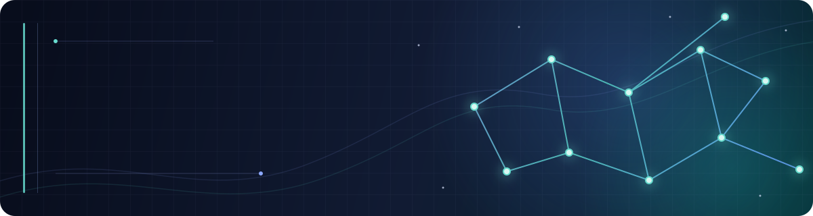
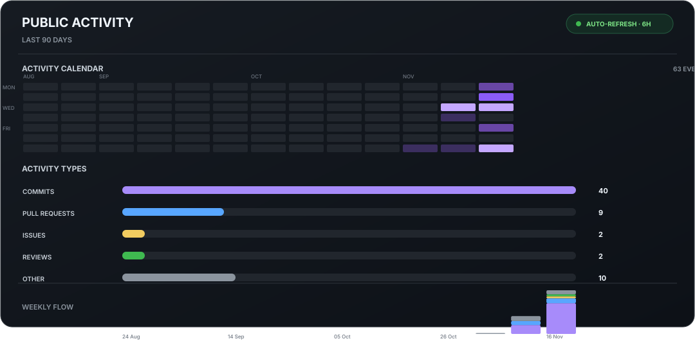

# Harsh Singh

### AI Reasoning · Hierarchical Computation · Research Engineering

**Computer Science student exploring how intelligent systems reason, plan, and verify — not just generate more tokens.**

  <a href="#projects-and-repositories">PROJECTS</a> &nbsp;·&nbsp;
  <a href="#technical-toolkit">TECHNICAL TOOLKIT</a> &nbsp;·&nbsp;
  <a href="#github-activity">GITHUB ACTIVITY</a>

---

## About

I'm a Computer Science student interested in **AI reasoning, research engineering, and reliable agentic systems**. I build research tools, interactive experiments, and software workflows that make complex ideas easier to inspect, test, and reproduce.

My focus is on **evidence over appearance, verification over assumption, and useful systems over impressive demos**.

## Projects and Repositories

A map of my public work across AI research, agent engineering, specialist toolkits, and applied systems. Each project name opens its repository.

### AI Reasoning and Research

- **[ARGUMENTUM Research Engine](https://github.com/voyager67/Argumentum-Research-engine)** — A self-hosted, multi-agent research pipeline for literature discovery, evidence mapping, methodological critique, and auditable research outputs.
- **[ReasoningAI Studio](https://github.com/voyager67/Reasoningai.studio)** — An evidence-first research toolkit with portable skills, reusable prompts, templates, and local utilities for reproducible research.
- **[Neural Networks Playground](https://github.com/voyager67/Neural-Networks-Playground)** — An interactive machine-learning lab for training small neural networks and inspecting activations, gradients, optimizers, and decision boundaries.
- **[Algorithm DSA Forge](https://github.com/voyager67/Algorithm-Dsa-Forge-Visualizer)** — A visual learning environment for data structures, algorithms, pathfinding, machine learning, and AI reasoning, with step-by-step execution.

### Agentic Engineering and Developer Tools

- **[The Startup — Gemini CLI Edition](https://github.com/voyager67/the-startup-gemini)** — A Gemini CLI-native engineering workflow with specialist agents, spec-driven development, adversarial reviews, and security and cost gates.
- **[LaunchCrew](https://github.com/voyager67/Launchcrew)** — A Codex-first, spec-driven toolkit for turning product ideas into scoped plans, delegated implementation, verified changes, and clear handoffs.
- **[Claude Garage](https://github.com/voyager67/Claude-Garage)** — A Claude Code plugin that brings structured startup-style workflows to planning, parallel building, testing, auditing, and shipping.
- **[Agent Workbench](https://github.com/voyager67/Agent-Workbench)** — A portable library of agent skills, role blueprints, and templates for software engineering, research, and delivery.
- **[AgentFieldkit](https://github.com/voyager67/AgentFieldkit)** — Evidence-first playbooks for repository exploration, software engineering, security, AI/ML research, and multi-agent collaboration.
- **[Implicit State Machines](https://github.com/voyager67/Implicit-State-Machines-)** — Agent workflows for finding hidden application lifecycles and refactoring fragile, boolean-heavy state into explicit, testable models.

### Specialist Agent Skill Libraries

- **[Agentic Skill Garage](https://github.com/voyager67/Agentic-Skill-Garage)** — Creative-production workflows for AI agents, supported by local Python tools for asset preparation, media operations, and deliverable checks.
- **[JaneStreet Agentic Skills](https://github.com/voyager67/JaneStreet-Agentic-Skills)** — Specialist playbooks for quantitative trading, market microstructure, order-book systems, low-latency engineering, risk controls, and research validation.
- **[KINETIQ Machine Simulation Skills](https://github.com/voyager67/KINETIQ-Machine-Simulation-Skills)** — Portable skills for interactive 3D machine explainers, mechanical simulation, physics validation, and offline delivery.
- **[Pixelcraft](https://github.com/voyager67/Pixelcraft)** — A design-quality skill library that helps agents detect generic interfaces and improve hierarchy, typography, layout, accessibility, and consistency.

### Applied AI and Product Systems

- **[MarketPilot AI](https://github.com/voyager67/MarketPilot-AI)** — A model-agnostic trading research toolkit for market scans, risk checks, scenario replay, walk-forward evaluation, and paper-only workflows.
- **[The Sharks](https://github.com/voyager67/The-Sharks)** — A multi-agent startup evaluation panel that pressure-tests customers, revenue, unit economics, competition, and founder-market fit.
- **[Kinoquence](https://github.com/voyager67/kinoquence)** — A local-first, model-agnostic production workflow for animated shorts, with structured storyboards, asset tracking, captions, credits, and quality checks.
- **[SheerFlow — SheerID Workflow Studio](https://github.com/voyager67/Sheerid-Workflow-Studio)** — A JavaScript workbench for authorized SheerID API integrations, verification workflows, document uploads, and auditable job tracking.
- **[CampusFlow](https://github.com/voyager67/Campusflow)** — A classroom-attendance prototype with rotating QR check-ins, duplicate prevention, and CSV reporting; built around fictional demonstration data.

### Security and Inspection Tools

- **[HoneyPot Guard](https://github.com/voyager67/HoneyPot-Guard)** — A local-first pre-commit scanner for leaked secrets, suspicious outbound endpoints, and risky code patterns.
- **[Claude Bundle Domain Inspector](https://github.com/voyager67/Bundlesleuth-claude-domain-inspector)** — A small macOS utility for inspecting narrowly scoped domain strings in Claude Code bundles, without executing the inspected binary or making network requests.

### Open-Source Reference

- **[MAPIE](https://github.com/voyager67/MAPIE)** — A repository copy of the [upstream MAPIE project](https://github.com/scikit-learn-contrib/MAPIE), a scikit-learn-compatible library for conformal prediction and risk control. Listed as an ecosystem reference, not as original authorship.

## Technical Toolkit

**Languages and Runtime**

**AI, Machine Learning, and Research**

**Agentic Development**

**Engineering and Workflow**

## GitHub Activity

  

